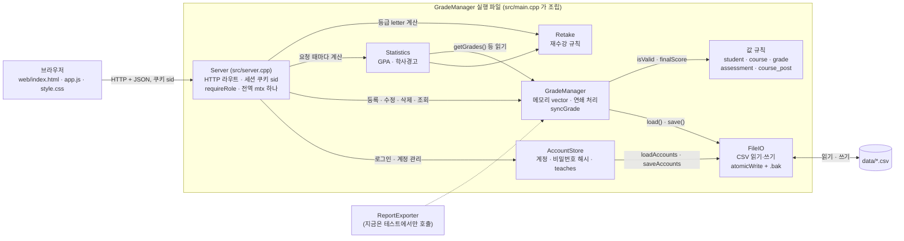
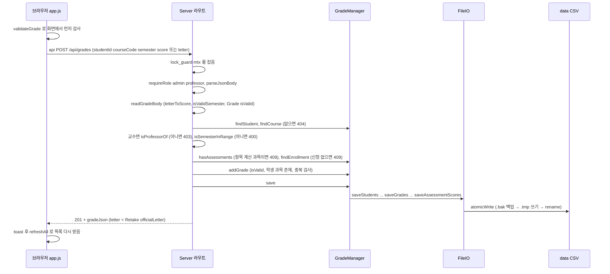
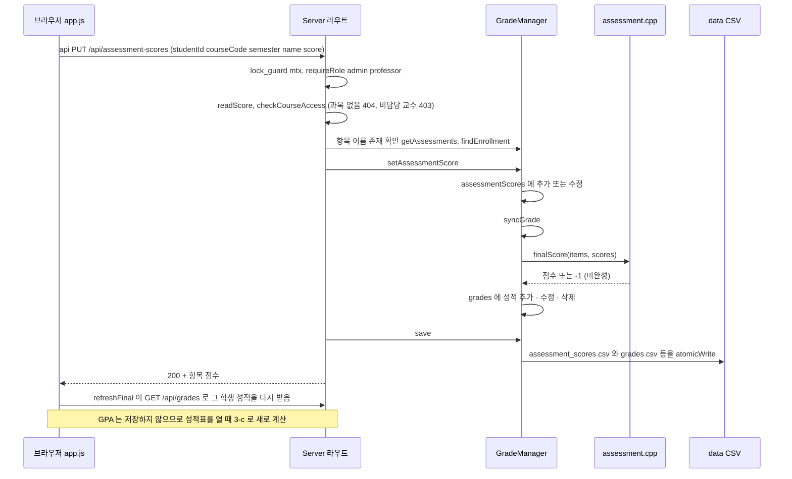
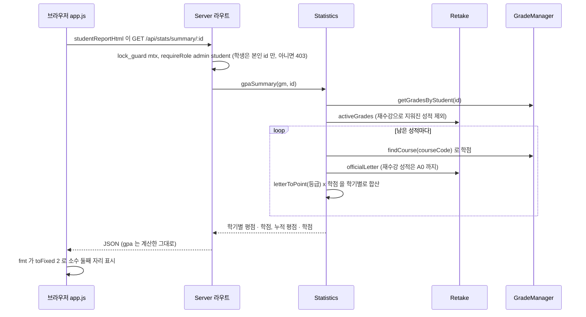

# 구조 설명서 (발표·질의응답용)

심사 기준 4번 "구조적 이해" (`docs/judging-criteria.md`)에 답하기 위한 문서입니다. 구성 요소가 어떻게 나뉘는지, 데이터가 어떻게 흐르는지, 왜 그렇게 만들었는지, 무엇을 바꾸면 어디가 바뀌는지를 정리했습니다.

- 이 문서의 모든 함수·파일 이름은 저장소의 실제 코드(`src/`, `include/`, `web/`, `tests/`, `data/`, `CMakeLists.txt`)에서 확인한 것입니다.
- 코드에서 이유를 찾을 수 없는 설계 판단은 **(팀 판단)** 으로 표시했습니다.
- API·데이터 칸 전체 표와 화면별 시연 순서는 `README.md` 에 있습니다. 여기서는 되풀이하지 않습니다.

---

## 1. 한 장 구조도

읽는 법

- 브라우저는 `web/` 의 정적 파일(`svr.set_mount_point("/", webDir)`)을 받아 와서 순수 JavaScript(`web/app.js`, 프레임워크 없음)로 `/api/*` 를 호출합니다. 화면은 서버가 준 JSON 을 그릴 뿐이고, 저장된 데이터의 기준은 서버입니다.
- `Server` 는 요청 하나를 "로그인 확인 → 역할 확인 → 본문 검사 → `GradeManager` 호출 → `gm.save()` → JSON 응답" 순서로 처리합니다.
- `GradeManager` 는 학생·과목·성적·수강신청·게시물·평가 항목·항목 점수를 `std::vector` 로 메모리에 들고 있고, 파일은 `FileIO` 를 통해서만 만집니다.
- GPA·학사경고는 `Statistics`(namespace 함수 모음)가 `GradeManager` 를 읽기만 해서 계산합니다. 계산 결과를 저장하는 곳은 없습니다.
- `AccountStore` 는 `GradeManager` 와 별개로 `accounts.csv` 만 담당합니다 (`FileIO` 인스턴스를 따로 가짐).
- `main.cpp` 는 `GradeManager`, `AccountStore` 를 만들어 `load()` 한 뒤 `Server` 에 넘기고 `run()` 을 부르는 조립만 합니다 (`AccountStore::ensureAdmin` 으로 첫 관리자도 만듦).
- 서버는 `svr.listen("127.0.0.1", port)` 로 이 컴퓨터에서만 접속할 수 있게 열립니다.

---

## 2. 모듈 책임표

"의존"은 실제 `#include` 를 확인한 것입니다 (`.h` 의 include 와, `.cpp` 에만 있는 include 를 구분). 표준 라이브러리는 뺐습니다.

### 값(데이터) 규칙 — 다른 모듈에 의존하지 않는 바닥층

| 파일 | 책임 | 의존 |
|---|---|---|
| `include/student.h`, `src/student.cpp` | `Student` 구조체, `isValid` (학번 숫자 8자리·이름·학년) | 없음 |
| `include/course.h`, `src/course.cpp` | `Course` 구조체, `isValid`, `isValidCourseCode`, `courseCategories`, `courseLanguages`, `isValidSchedule`, `schedulesOverlap` | 없음 |
| `include/grade.h`, `src/grade.cpp` | `Grade` 구조체, 점수→등급 `scoreToLetter`, 등급→평점 `letterToPoint`, 등급→대표 점수 `letterToScore`, 학기 규칙 `isValidSemester` · `isRegularSemester` · `isSemesterInRange`, `admissionYear` | cpp: `course.h` |
| `include/enrollment.h` | `Enrollment` 구조체 (학번, 과목코드, 학기). 헤더만 있음 | 없음 |
| `include/assessment.h`, `src/assessment.cpp` | `Assessment`, `AssessmentScore`, `isValid`, 최종 점수 `finalScore` | cpp: `course.h`, `grade.h` |
| `include/course_post.h`, `src/course_post.cpp` | `CoursePost`, `postCategories`, `isValid` (분류·주차 1~16·제목·링크·날짜 검사) | cpp: `grade.h` |

### 저장·계정

| 파일 | 책임 | 의존 |
|---|---|---|
| `include/file_io.h`, `src/file_io.cpp` | `FileIO`: CSV 9종(학생·과목·성적·수강신청·설정·계정·게시물·평가 항목·항목 점수)의 `save*`/`load*`, `joinCsvLine`, `atomicWrite`, `backup`, 줄 단위 오류 경고 | h: `assessment.h` `course.h` `course_post.h` `enrollment.h` `grade.h` `student.h` (`Account` 는 선언만). cpp: `account.h` |
| `include/account.h`, `src/account.cpp` | `Account`, `AccountStore`(계정 추가·수정·삭제·로그인 확인·비밀번호 변경), `sha256Hex`, `hashPassword`, `teaches`(담당 과목 판정) | h: `course.h`, `file_io.h` |

### 핵심 로직

| 파일 | 책임 | 의존 |
|---|---|---|
| `include/grade_manager.h`, `src/grade_manager.cpp` | `GradeManager`: 메모리 vector 보관, 등록·수정·삭제·조회, 연쇄 처리(`updateStudent`·`removeStudent`·`updateCourse`·`removeCourse`), 평가 항목 → 성적 동기화(`syncGrade`·`syncCourse`), `load()`/`save()` | h: `assessment.h` `course.h` `course_post.h` `enrollment.h` `file_io.h` `grade.h` `student.h` |
| `include/retake.h`, `src/retake.cpp` | `Retake::isReplaced` · `isRetake` · `officialLetter`(R, 재수강 A+→A0) · `activeGrades` · `admittedSince2018` | h: `grade.h` |
| `include/statistics.h`, `src/statistics.cpp` | `Statistics::calcGPA` · `gpaSummary` · `courseStats` · `academicWarnings`. 데이터를 바꾸지 않는 계산 전용 | h: `grade_manager.h`. cpp: `retake.h` |
| `include/report_exporter.h`, `src/report_exporter.cpp` | `ReportExporter::studentReport` · `courseReport`: 성적표 CSV 문자열 (UTF-8 BOM, 수식 주입 방지 `safeCell`) | h: `grade_manager.h`. cpp: `retake.h`, `statistics.h` |
| `include/server.h`, `src/server.cpp` | `Server`: 라우트 등록, 세션(`sessionToken` · `currentAccount`), 역할 확인 `requireRole`, JSON 변환, 오류 문구 | h: `account.h`, `grade_manager.h`. cpp: `statistics.h` `course_post.h` `retake.h` `report_exporter.h`, `httplib.h`, `json.hpp` |
| `src/main.cpp` | 데이터 폴더(`PROJECT_ROOT/data`)를 열고 `GradeManager`·`AccountStore`·`Server` 를 만들어 실행 | `account.h` `grade_manager.h` `server.h` |

### 화면·빌드·검증

| 파일 | 책임 |
|---|---|
| `web/index.html`, `web/style.css`, `web/app.js` | 단일 페이지 UI. 탭마다 `renderers` 의 함수가 서버에서 받아 그림. `api()` 가 모든 호출을 모으고 401 이면 로그인 화면으로 돌아감 |
| `third_party/httplib.h`, `third_party/json.hpp` | cpp-httplib(HTTP 서버), nlohmann/json — 헤더만 있는 외부 코드. 그 밖의 라이브러리는 없음 (SHA-256 도 `account.cpp` 에 직접 구현) |
| `CMakeLists.txt` | `src/*.cpp` 중 `main.cpp` 를 뺀 것을 정적 라이브러리 `grade_core` 로 묶고, 실행 파일 `GradeManager` 와 테스트 `GradeTests` 가 같이 링크 (`file(GLOB ... CONFIGURE_DEPENDS)` 라 새 `.cpp` 는 자동 포함). `PROJECT_ROOT` 를 컴파일 정의로 넘김 |
| `tests/` | `check.h`(TEST_CASE·CHECK 매크로) + `test_main.cpp`(등록된 테스트를 모두 실행) + 모듈별 `test_*.cpp`. `test_support.h` 의 `TempDir` 로 임시 폴더만 씀 (`data/` 는 건드리지 않음) |
| `.github/workflows/` | CI: cmake 빌드 → `ctest --test-dir build --output-on-failure` |

의존 방향 요약: 값 규칙 ← `FileIO` ← `GradeManager` ← (`Statistics`, `ReportExporter`, `Server`) ← `main`. `Retake` 는 `Grade` 만 알고, `Statistics`·`Server`·`ReportExporter` 가 가져다 씁니다. `AccountStore` 는 `FileIO` 와 `Course`(담당 과목 판정용)만 알고 `GradeManager` 는 모릅니다. 반대로 `GradeManager` 는 계정·역할을 전혀 모릅니다 (`src/grade_manager.cpp`, `include/grade_manager.h` 에 account·role 참조 없음).

현재 코드 기준으로 알아 둘 점: `server.cpp` 가 `report_exporter.h` 를 include 하지만 `ReportExporter` 를 호출하는 곳은 `tests/test_retake.cpp` 뿐입니다. `/api/export/student/:id`, `/api/export/course/:code` 는 `server.cpp` 가 `escapeCSV` 로 CSV 를 직접 만들어 내려 줍니다 (열 구성도 `ReportExporter` 와 다름). 두 경로를 하나로 합치는 것은 정리 후보입니다 (팀 판단).

---

## 3. 데이터 흐름 예시 3개

### 3-a. 성적 하나 등록 (`POST /api/grades`)

1. `web/app.js` 의 `$('grade-add').onclick` → `openForm` → `validateGrade` → `api('POST', '/api/grades', gradeBody(d))`. 입력 방식이 "등급"이면 `letter`, "점수"이면 `score` 를 보냅니다.
2. `src/server.cpp` 의 `svr.Post("/api/grades")` 는 첫 줄에서 `std::lock_guard<std::mutex> lock(mtx)` 를 잡고, `requireRole(req, res, {"admin", "professor"})` 로 역할을 확인합니다 (학생이면 403, 로그인 안 했으면 401).
3. `readGradeBody` 가 본문을 검사합니다. `letter` 는 `letterToScore` 로 점수로 바꾸고, 학기는 `isValidSemester`, 나머지는 `Grade::isValid` 로 검사합니다 (틀리면 400).
4. 학생·과목 존재(404), 교수의 담당 과목 여부 `isProfessorOf` → `teaches`(403), 학생별 허용 학기 `isSemesterInRange`(400), 평가 항목 과목 `hasAssessments`(409), 이미 있는 성적 `findGrade`(409), 수강신청 없음 `findEnrollment`(409) 순서로 막습니다.
5. 통과하면 `gm.addGrade(grade)` (메모리 vector 에 추가) → `gm.save()`. 저장이 실패하면 500 입니다.
6. `GradeManager::save()` 는 학생·과목·성적·수강신청·설정·게시물·평가 항목·항목 점수 8개 파일을 차례로 `FileIO::save*` → `atomicWrite` 로 다시 씁니다 (바뀐 성적 파일만이 아니라 8개 모두). 계정 파일은 `AccountStore::save()` 가 따로 씁니다.
7. 응답은 `201` + `gradeJson` 입니다. `letter` 는 저장된 값이 아니라 `Retake::officialLetter(grade, gm.getGrades())` 로 지금 계산한 값입니다.

### 3-b. 평가 항목 점수를 바꾸면 → 성적 → GPA

1. 점수 칸을 바꾸면 `$('assess-body').addEventListener('change', ...)` 가 숫자면 `PUT /api/assessment-scores`, 빈칸이면 `DELETE /api/assessment-scores?...` 를 부릅니다.
2. 서버 라우트는 `readScore`(0~100), `checkCourseAccess`(없는 과목 404, 담당이 아닌 교수 403)를 거친 뒤 `gm.setAssessmentScore(score)` 를 부릅니다. 이 함수는 항목 존재와 수강신청(`findEnrollment`)을 다시 확인하고 `assessmentScores` 를 수정합니다.
3. 곧바로 `syncGrade(studentId, courseCode, semester)` 가 그 학생의 항목과 점수를 모아 `finalScore(items, scores)` (`src/assessment.cpp`) 를 부릅니다. 비율 합계가 100 이 아니거나 점수 없는 항목이 있으면 `-1` 이고, 그러면 `grades` 의 그 성적을 지웁니다. 0 이상이면 성적을 추가하거나 점수를 바꿉니다.
4. 항목 자체를 바꾸는 경우(`addAssessment` · `updateAssessment` · `removeAssessment`)는 `syncCourse` 가 그 과목·학기에 수강신청한 학생 전원에게 `syncGrade` 를 돌립니다.
5. 라우트가 `gm.save()` 로 저장하면 `assessment_scores.csv` 와 `grades.csv` 가 바뀝니다.
6. 이렇게 만들어진 성적은 평범한 `Grade` 라서 GPA·재수강·학사경고 코드는 그대로 씁니다 (`include/assessment.h` 머리 주석, README "평가 항목 성적"). 항목 계산 과목의 성적을 직접 등록·수정·삭제하는 것은 서버가 409 로 막습니다 (`kAssessedCourse`).
7. 이 경우 성적 점수(`grades.csv`)는 계산 결과를 파일에 저장하는 유일한 예외입니다. 그래서 `finalScore` 계산식을 바꿔도 이미 저장된 성적은 다음 `syncGrade`·`syncCourse` 가 불리기 전까지 그대로입니다 (`load()` 는 다시 계산하지 않음).

### 3-c. GPA 조회 (요청 때마다 계산, 캐시 없음)

1. `GET /api/stats/summary/:id` 의 `gpaSummary` 와 `GET /api/stats/gpa/:id` 의 `calcGPA` 는 같은 내부 함수 `sumBySemester` 를 씁니다. `Retake::activeGrades(gm.getGradesByStudent(id))` 로 지워진 성적을 빼고, 과목별 학점은 `gm.findCourse(...)->credit`, 평점은 `letterToPoint(Retake::officialLetter(...))` 로 구해서 학기별로 (평점 × 학점) 합과 학점 합을 모읍니다. GPA = 합 ÷ 학점 합입니다.
2. 학사경고는 `Statistics::academicWarnings` 가 수강신청·성적에서 매번 판정합니다 (재수강 규칙을 쓰지 않고 원래 성적 `scoreToLetter` 사용).
3. 캐시가 없음을 확인한 근거: `grades.csv` 의 칸은 `studentId,courseCode,semester,score` 뿐이라 등급·GPA 를 저장하는 곳이 없고 (`FileIO::saveGrades`), `src/` 에서 `cache` 를 검색해도 결과가 없으며 `static` 변수는 목록 상수(`courseCategories` 등)뿐이라 계산 결과를 담아 두는 변수가 없습니다. 그래서 성적을 고치거나 지우면 다음 조회부터 값이 달라집니다.
4. 소수 둘째 자리 표시는 서버가 아니라 `web/app.js` 의 `fmt` 가 합니다 (서버는 계산한 `double` 을 그대로 JSON 에 담음).

---

## 4. 설계 이유

각 항목은 "근거"(코드·주석·README 에서 확인한 것)와 "대가"(그 선택의 한계)로 나눴습니다. 근거를 코드에서 찾을 수 없는 부분은 (팀 판단)으로 표시했습니다.

### 왜 DB 가 아니라 CSV 파일인가

- 근거
  - 심사 기준의 필수 ④는 저장 방식을 "LocalStorage, JSON 파일, SQLite 등 자유 선택"으로 둡니다 (`docs/judging-criteria.md`).
  - README 문제 정의가 "설치 없이 브라우저로 접속하고 데이터는 CSV 파일로 남습니다"입니다. 데이터베이스 서버나 DB 라이브러리를 따로 설치하지 않고 `cmake` 만으로 빌드됩니다 (외부 코드는 `third_party/` 의 헤더 2개).
  - 샘플 데이터를 `data/` 에 git 으로 같이 관리하고, 시연 뒤 `git diff data/` 로 바뀐 내용을 보고 `git checkout -- data/` 로 되돌립니다 (README "데이터"). 텍스트 파일이라 이 흐름이 가능합니다.
  - 쉼표·따옴표가 든 값은 `joinCsvLine`·`splitLine` 이 처리합니다 (README 의 담당 교수 `"최정훈, 한수진"` 사례, `tests/test_file_io.cpp` 의 `fileIO_roundtrip_keeps_special_values`).
- 대가
  - 관계 제약(외래 키)이 없어서 학번·과목코드가 바뀌거나 지워질 때 연결된 데이터를 `GradeManager` 가 직접 고칩니다 (5절 표).
  - 바꿀 때마다 8개 파일 전체를 다시 씁니다 (`GradeManager::save`). 데이터가 학생 9명·과목 6개 규모라는 전제(README 대상: 소규모 학과)에서만 부담이 없습니다 (팀 판단).

### 왜 전역 mutex 하나인가

- 근거
  - cpp-httplib 은 요청을 스레드 풀에서 동시에 처리합니다 (`third_party/httplib.h` 의 `ThreadPool`, `CPPHTTPLIB_THREAD_POOL_COUNT`). `gm`, `accounts`, `sessions` 는 공유 객체입니다.
  - `include/server.h` 주석이 "gm, accounts, sessions 를 쓰는 모든 라우트는 첫 줄에 `std::lock_guard<std::mutex> lock(mtx);`" 를 규칙으로 정해 두었고, `server.cpp` 의 모든 라우트가 그렇게 시작합니다.
  - `GradeManager::findStudent` 같은 `find*` 는 vector 원소의 주소를 돌려주고, "벡터에 추가/삭제가 일어나면 이 포인터는 무효가 될 수 있어서 바로 쓰고 버려야 한다"는 주석이 있습니다 (`src/grade_manager.cpp`). 요청 전체를 한 잠금으로 감싸면 라우트 안에서 포인터를 쓰는 동안 다른 요청이 vector 를 바꾸지 못합니다.
  - 검사와 변경이 한 잠금 안에 있으므로 "정원 확인 → 수강신청 추가 → 저장"(`POST /api/enrollments`)이 중간에 끼어들기 없이 끝납니다.
- 대가: 읽기 요청도 모두 한 줄로 처리됩니다. 정적 파일(`web/`)은 `svr.set_mount_point` 로 등록되어 있어 라우트 람다의 `mtx` 를 잡지 않습니다. 요청 수가 적은 소규모 학과를 전제로 한 단순함 우선 선택입니다 (팀 판단).

### 왜 GPA · 재수강 · 학사경고를 읽을 때 계산하는가

- 근거
  - `grades.csv` 에는 점수만 저장하고 (`studentId,courseCode,semester,score`) 등급·평점은 저장하지 않습니다.
  - 재수강 판정은 같은 학생·과목의 더 늦은 학기 성적이 있느냐로 결정됩니다 (`Retake::isReplaced` · `isRetake`). 나중 학기 성적을 등록하거나 지우면 이전 성적의 등급 표시(R, A0 제한)와 GPA 가 함께 바뀌어야 하는데, 값을 저장해 두면 그때마다 맞춰 고쳐야 합니다. 읽을 때 계산하면 원본(점수·수강신청)이 하나뿐이라 어긋날 수 없습니다.
  - `include/retake.h` 주석: 삭제된 성적도 `grades.csv` 에 그대로 남기는 이유가 "성적표의 R 표시와 학사경고 판단에 필요"하기 때문입니다.
  - 학사경고는 "이미 내려진 학사경고는 유지"해야 하므로 재수강 규칙을 적용하지 않고 원래 성적(`scoreToLetter`)으로 판정합니다 (`include/statistics.h`).
- 예외: 평가 항목으로 만든 최종 점수는 `syncGrade` 가 `grades` 에 저장합니다. 계산 결과를 평범한 성적으로 만들어 나머지 코드(GPA·재수강·학사경고·성적표)를 그대로 쓰기 위해서입니다 (README "평가 항목 성적", `include/assessment.h`).

### 왜 역할 확인을 서버에서 하는가

- 근거
  - 화면은 `data-roles` 로 탭을 숨기고 `app.js` 의 `teaches`·`myCourses` 로 보이는 과목을 거르지만, 이것은 사용 편의입니다. 실제 판단은 서버에 있습니다: 공개 라우트인 `POST /api/login` 을 뺀 모든 라우트가 `requireRole` 로 시작하고 (로그인 안 함 401, 역할 불일치 403), 이어서 소유 확인(학생의 본인 학번 비교, 교수의 `isProfessorOf` → `teaches`)을 합니다. 예: 학생이 `GET /api/stats/gpa/<남의 학번>` 을 직접 부르면 403 (`server.cpp`).
  - `GradeManager` 는 계정·역할을 모르는 순수 데이터 계층이고, `teaches` 는 `account.h` 에 있습니다. 규칙이 `Server` 한 곳에 모여 있어서 권한을 바꿀 때 볼 곳이 한정됩니다 (5절).
  - `app.js` 의 `teaches` 에는 "서버 `teaches` 와 같은 규칙"이라는 주석이 있습니다 (화면에서 보이는 과목을 거르는 용도).
- 대가: 같은 규칙이 `account.cpp`(서버)와 `app.js`(화면) 두 곳에 있어서 담당 과목 판정을 바꾸면 둘 다 고쳐야 합니다.

### 왜 atomic write + `.bak` 인가

- 근거
  - `include/file_io.h` 머리 주석: "기존 파일을 .bak 으로 백업 → 임시파일에 쓰기 → rename (중간에 꺼져도 원본 보존)". `FileIO::atomicWrite` 주석도 같은 순서입니다 (백업 → `path.tmp` 에 쓰기 → `path` 로 이름 바꾸기).
  - `.bak`, `.tmp` 는 `.gitignore` 에 있고, README 는 "직전 내용은 `.bak`"이라고 안내합니다.
  - `atomicWrite` 는 `rename` 이 실패하면(코드 주석: 일부 Windows 컴파일러 MinGW 는 대상 파일이 있으면 실패) 원본을 지우고 한 번 더 시도합니다. 주석은 이 시점에 `.bak` 백업을 이미 해 둔 상태라고 적고 있습니다.
- 한계 (코드 확인)
  - 파일 하나씩은 안전하지만 여러 파일을 한 번에 바꾸는 트랜잭션은 아닙니다. `GradeManager::save()` 는 8개 파일을 차례로 쓰고 하나라도 실패하면 거기서 멈추며, 계정 파일은 `AccountStore::save()` 가 별도로 씁니다.
  - 라우트에서 `gm.save()` 가 실패하면 500 을 돌려주지만 메모리에서 바꾼 내용은 되돌리지 않습니다.
  - `.bak` 이 실제로 만들어지는지를 직접 검사하는 테스트는 없습니다 (`tests/` 에서 `bak`·`atomic` 검색 결과 없음).

---

## 5. "이걸 바꾸면 어디가 바뀔까"

아래 표의 파일은 이름·함수를 `grep` 으로 확인한 것입니다. "화면"은 `web/app.js` 를 가리킵니다.

| 바꾸려는 것 | 같이 고칠 곳 |
|---|---|
| **등급 기준** (점수→등급 경계, 평점표, 등급 이름) | `src/grade.cpp` 의 `scoreToLetter` · `letterToPoint` · `letterToScore`. `src/retake.cpp` 의 `officialLetter` (A+ → A0 제한이 등급 문자열 `"A+"` 에 의존). `src/statistics.cpp` 는 `letterToPoint` · `scoreToLetter` 를 불러 쓰므로 자동 반영. 서버: `src/server.cpp` 의 `kLetterRules` 문구. 화면: `app.js` 의 `GRADE_LETTERS` · `scoreToLetter`(예상 등급용 복제) · 점수/등급 입력 안내 문구(`gradeFields`), 배지 색 `web/style.css` 의 `.badge.A` ~ `.badge.R` (등급 첫 글자로 클래스를 정함, `letterBadge`). 테스트 `tests/test_grade.cpp`. 문서 `include/grade.h` 주석, README. 이미 저장된 `grades.csv` 는 점수만 있어서 데이터 수정은 필요 없음 |
| **새 CSV 칸 추가** (예: 과목에 칸 1개) | 구조체(`include/course.h`)와 `isValid`(`src/course.cpp`). `src/file_io.cpp` 의 `kCoursesHeader` · `saveCourses` · `loadCourses` (칸 위치로 읽으므로 번호 확인, 옛 형식을 계속 읽으려면 `kCoursesLegacyHeader` 처럼 `readCsv` 의 `headers` 에 옛 헤더를 남김). `data/courses.csv`. 서버: `POST`·`PUT /api/courses` 의 본문 읽기, `courseJson`, `courseInvalidReason`. 화면: `courseFields`·`courseBody`·`showCourseDetail`. 테스트 `tests/test_file_io.cpp`. README "데이터" 표와 JSON 필드 설명 |
| **새 데이터 종류(CSV 파일) 추가** (예: `course_posts.csv` 를 넣을 때 건드린 곳) | `include/course_post.h` + `src/course_post.cpp`. `include/file_io.h` · `src/file_io.cpp` 의 `savePosts` · `loadPosts`. `GradeManager` 멤버 `posts` 와 `load()` · `save()` · 추가/수정/삭제 메서드, 그리고 `updateCourse` · `removeCourse` 의 연쇄 처리. 서버 라우트. `tests/test_support.h` 의 `makePost` 와 `tests/test_course_post.cpp`. `data/course_posts.csv`. `CMakeLists.txt` 는 `file(GLOB)` 이라 수정 불필요 |
| **새 API 라우트 추가** | `src/server.cpp` 의 `Server::run()` 에 `svr.Get/Post/Put/Delete` 추가: 첫 줄 `lock_guard`, 이어서 `requireRole`. 데이터를 바꾸면 성공 뒤 `gm.save()` (계정은 `accounts->save()`). `/api/stats/warnings` 처럼 고정 경로는 `:id` 경로보다 먼저 등록 (소스 주석). 문서: `include/server.h` 머리 주석의 라우트 표, README API 표·권한 표. 화면: `app.js` 에서 `api(...)` 호출과 화면. 서버 라우트를 직접 부르는 자동 테스트는 없음 |
| **역할 권한 변경** (누가 무엇을 하는가) | `src/server.cpp` 해당 라우트의 `requireRole(req, res, {...})` 목록과 그 뒤 소유 확인(`isProfessorOf`, `account->studentId` 비교, `checkCourseAccess`). 담당 과목 규칙은 `src/account.cpp` 의 `teaches`. 화면: `web/index.html` 의 `data-roles`, `app.js` 의 `myCourses` · `gradeCourses` · `teaches` 와 버튼 표시 조건. 문서: README "로그인 / 역할" 표, `include/server.h` 주석 |
| **학기 형식 변경** (`YYYY-N`) | `src/grade.cpp` 의 `isValidSemester` · `isRegularSemester` · `isSemesterInRange` (연도를 `substr(0, 4)` 로 읽음). `src/statistics.cpp` 의 `splitSemester` · `makeSemester` (`semester[5]` 위치 사용) 와 학사경고의 학기 순회. `src/retake.cpp` 는 학기 문자열 비교(`>`, `<`)가 시간 순서라는 가정에 의존 (`isReplaced` · `isRetake` · `activeGrades`), 서버의 정렬도 문자열 비교. `src/server.cpp` 의 `kSemesterRules` · `kGradeRules`. 화면: `app.js` 의 `SEMESTER_RE` · `sortSemesters` · `SEMESTER_RULES`. 이미 저장된 CSV 의 학기 값(`grades` · `enrollments` · `assessments` · `assessment_scores` · `course_posts` · `settings`). 테스트 `tests/test_grade.cpp` |
| **과목 코드 변경** (과목 수정에서 코드를 바꿀 때) | 연쇄는 `GradeManager::updateCourse` 한 곳: 성적(`grades`), 수강신청(`enrollments`), 게시물(`posts`), 평가 항목(`assessments`), 항목 점수(`assessmentScores`) 의 `courseCode` 를 같이 바꿈. 삭제(`removeCourse`)도 같은 5개를 지움. 코드 형식 규칙은 `isValidCourseCode`(`src/course.cpp`). 계정(`accounts.csv`)에는 과목코드가 없고 담당은 교수 이름 기준이라 영향 없음. 새 데이터 종류가 과목코드를 가지면 이 두 함수에 연쇄를 추가해야 함. 테스트 `tests/test_grade_manager.cpp` 의 `updateCourse_code_change_rewrites_grades`, `assessments_cascade_course_code_and_student_changes` |
| **학번 변경** (학생 수정에서) | `GradeManager::updateStudent` 가 성적 · 수강신청 · 항목 점수의 `studentId` 를 바꿈. 계정은 `GradeManager` 밖이라 서버 `PUT /api/students/:id` 가 `accounts->relinkStudent` 와 `accounts->save()` 를 따로 부름. 삭제는 `removeStudent` + `accounts->removeStudentAccounts` + 해당 세션 제거 (`DELETE /api/students/:id`) |
| **평가 항목 최종 점수 계산식** | `src/assessment.cpp` 의 `finalScore`. 호출은 `GradeManager::syncGrade` 뿐이지만 이미 저장된 성적은 다시 계산하지 않음 (3-b). 화면의 "현재까지 환산"(`app.js` `myAssessmentsHtml`)은 별도로 JS 에서 계산하므로 같이 고쳐야 함. 테스트 `tests/test_assessment.cpp` · `tests/test_grade_manager.cpp` |
| **학사경고 기준** (1.75, 수강신청 미이행) | `src/statistics.cpp` 의 `academicWarnings` (`1.75`, `credits < 1`), `include/statistics.h` 주석. 화면 `app.js` 의 `WARNING_GPA` (GPA 그래프의 점선). README "재수강 규칙" 절의 학사경고. 테스트 `tests/test_statistics.cpp` |
| **이수구분·강의언어 목록** | `src/course.cpp` 의 `courseCategories` · `courseLanguages`. 화면 `app.js` 의 `COURSE_CATEGORIES` · `COURSE_LANGUAGES` (주석에 "서버와 같아야 함"). 서버 `courseInvalidReason` 은 서버 목록을 씀 |
| **세션 유효 시간** (8시간) | `src/server.cpp` 로그인 라우트의 `std::chrono::hours(8)` 와 쿠키 `Max-Age=28800`. 주석 `include/server.h`, README |

---

## 6. 예상 질문과 답

**Q1. 왜 DB 가 아니라 CSV 로 저장했나요?**
A. 심사 기준이 저장 방식을 자유롭게 두었고 (필수 ④), 설치 없이 `cmake` 만으로 빌드·실행되게 하려고 CSV 파일을 썼습니다. `data/` 를 git 으로 같이 관리해서 시연이 끝나면 `git checkout -- data/` 로 샘플 데이터로 돌아갑니다. 대신 외래 키가 없어서 과목코드·학번이 바뀌거나 지워질 때 연결된 데이터를 `GradeManager` 의 `updateCourse` · `removeCourse` · `updateStudent` · `removeStudent` 가 직접 고칩니다. 5절 표 참고.

**Q2. 여러 명이 동시에 접속하면 어떻게 되나요?**
A. cpp-httplib 이 요청을 스레드 풀에서 동시에 처리하지만, 모든 라우트가 `mtx` 하나를 잡고 시작하므로 데이터를 쓰는 코드는 한 번에 하나만 실행됩니다 (`include/server.h` 주석의 규칙). 정원 확인과 수강신청 추가처럼 "확인 후 변경"이 한 잠금 안에 있어서 중간에 다른 요청이 끼지 않습니다. 대신 요청이 한 줄로 처리되는 단순한 방식이라 소규모 학과 규모를 전제로 합니다.

**Q3. 비밀번호는 어떻게 저장하나요?**
A. 원문은 저장하지 않습니다. 계정마다 `random_device` 로 만든 16바이트(hex 32자) salt 를 두고, `hashPassword` 가 `sha256(salt + 비밀번호)` 에 `sha256(d + salt)` 를 9999번 더 적용합니다 (총 10,000번). `accounts.csv` 에는 `salt`, `passwordHash` 만 있고 API 응답(`accountJson`)에는 해시가 들어가지 않습니다. SHA-256 은 외부 라이브러리 없이 `account.cpp` 에 직접 구현했고 `tests/test_account.cpp` 의 `sha256Hex_known_vectors` 가 알려진 값과 비교합니다. 반복 SHA-256 은 bcrypt·argon2 같은 비밀번호 전용 방식은 아니라는 한계가 있습니다. 로그인 세션은 쿠키 `sid`(HttpOnly, SameSite=Strict, 8시간)로 유지하고 서버 메모리에만 있어서 서버를 다시 켜면 모두 로그아웃됩니다. 서버는 `127.0.0.1` 에서만 열리고 HTTPS 는 쓰지 않습니다.

**Q4. 테스트는 어떻게 했나요?**
A. 외부 프레임워크 없이 `tests/check.h` 의 `TEST_CASE`·`CHECK` 매크로로 `GradeTests` 하나를 만들었습니다 (이 문서 작성 시점 `TEST_CASE` 99개, 등급 경계·재수강·평가 항목 계산·연쇄 삭제·CSV 저장/불러오기·계정 해시 등). `TempDir` 의 임시 폴더만 써서 `data/` 를 건드리지 않고, GitHub Actions(`.github/workflows/`)가 빌드와 `ctest` 를 돌립니다. 다만 HTTP 라우트를 직접 부르는 자동 테스트는 없고, README 의 시연 시나리오와 curl 예제로 확인합니다.

**Q5. GPA 는 어디서 어떻게 계산하나요? 저장해 두나요?**
A. 저장하지 않고 요청 때마다 `Statistics::gpaSummary` / `calcGPA` 가 계산합니다. `Retake::activeGrades` 로 재수강으로 지워진 성적을 빼고, `letterToPoint(Retake::officialLetter(...))` × 학점을 학기별로 합한 뒤 학점 합으로 나눕니다 (4.5 만점). `grades.csv` 에는 점수만 있으므로 성적을 고치거나 지우면 다음 조회에서 바로 달라집니다. 소수 둘째 자리 표시는 화면의 `fmt` 입니다.

**Q6. 재수강은 어떻게 처리하나요?**
A. 같은 학생이 같은 과목을 여러 학기에 들으면 가장 늦은 학기가 재수강 성적이고 이전 성적은 "삭제된 성적"입니다 (`Retake::isReplaced`). 삭제된 성적은 GPA·과목 통계·과목 성적표에서 빠지지만 `grades.csv` 에는 남습니다. 재수강 성적은 A0 까지만 인정합니다 (`officialLetter` 가 A+ 를 A0 로). 학생 성적표에서는 2018년 이후 입학생(`admittedSince2018`)은 지워진 과목을 `R` 로 보여 주고 그 전 입학생은 줄을 뺍니다. 학사경고는 이미 내려진 경고를 유지하려고 재수강 규칙 없이 원래 성적으로 판정합니다.

**Q7. 평가 항목(중간·기말·과제)으로 성적이 자동 계산되는 구조를 설명해 주세요.**
A. 교수가 (과목, 학기)별로 항목과 비율을 만들고 학생별 항목 점수를 넣으면, `GradeManager` 가 `syncGrade` 로 `finalScore` 를 계산해 `grades` 에 일반 성적으로 반영합니다 (비율 합계가 100 이 아니거나 점수가 빈 항목이 있으면 성적을 만들지 않고 있던 성적도 지움). 항목 자체를 바꾸면 `syncCourse` 가 수강생 전원을 다시 계산합니다. 결과가 평범한 성적이라 GPA·재수강 코드를 바꿀 필요가 없었고, 항목 계산 과목의 성적을 직접 수정하는 것은 서버가 409 로 막습니다. 자세한 흐름은 3-b.

**Q8. 권한은 어디서 막나요? 화면에서 버튼을 숨기면 되는 것 아닌가요?**
A. 서버가 막습니다. 공개 라우트인 `POST /api/login` 을 뺀 모든 라우트가 `requireRole` 로 시작해 로그인(401)과 역할(403)을 확인하고, 이어서 본인 학번이나 담당 과목(`teaches`)인지 확인합니다. 화면의 탭·버튼 숨김은 편의일 뿐이라 학생이 주소를 직접 호출해도 (예: 남의 GPA 조회) 403 이 나옵니다. 교수의 담당 과목은 과목의 담당 교수 이름(쉼표로 여러 명)과 계정 이름이 같은지로 정합니다. 권한 표는 README "로그인 / 역할".

**Q9. 과목 코드를 바꾸거나 학생·과목을 지우면 성적과 수강신청은 어떻게 되나요?**
A. `GradeManager` 가 연쇄 처리합니다. 과목코드를 바꾸면 `updateCourse` 가 성적·수강신청·게시물·평가 항목·항목 점수의 코드를 함께 바꾸고, 과목을 지우면 `removeCourse` 가 같은 5가지를 함께 지웁니다. 학번도 마찬가지이고(`updateStudent`, `removeStudent`), 학생 계정은 `GradeManager` 밖이라 서버가 `AccountStore` 로 따로 맞춥니다. 중간에 값이 틀리면 먼저 거절하고 마지막에 덮어쓰도록 되어 있습니다 (`updateStudent`·`updateCourse` 주석, `tests/test_grade_manager.cpp` 의 `updateCourse_to_existing_code_fails_without_changes`).

**Q10. 저장 도중 프로그램이 꺼지거나 CSV 가 깨지면요?**
A. 저장은 `.bak` 백업 → `.tmp` 에 쓰기 → rename 순서라 쓰는 도중에 꺼져도 원래 파일은 남습니다 (`FileIO::atomicWrite`). 읽을 때는 칸 수가 맞지 않거나 숫자가 아닌 줄은 경고를 출력하고 건너뛰고 (평가 항목·항목 점수·게시물은 `isValid` 도 확인), 파일이 없으면 빈 목록으로 시작합니다 (`readCsv`, `tests/test_file_io.cpp`). 한계로, 8개 파일을 한꺼번에 바꾸는 트랜잭션은 아니고 저장이 실패하면 500 을 돌려줄 뿐 메모리의 변경을 되돌리지는 않습니다.

**Q11. 프론트엔드는 어떻게 구성했나요?**
A. 프레임워크 없이 `web/index.html` 하나에 `app.js` 가 탭별 화면을 그리는 단일 페이지입니다. `renderers` 표가 탭 이름을 그리기 함수에 연결하고, `showTab` 은 학생·과목 목록(`loadBase`)을 30초 동안 캐시해 쓰고 (등록·수정·삭제 뒤 `refreshAll` 은 항상 새로 받음), 이미 그린 탭은 이전 화면을 그대로 보여 둔 채 서버 응답이 오면 제자리에서 갱신합니다. 탭을 빠르게 옮길 때 늦게 온 응답이 화면을 덮지 않도록 렌더 토큰(`renderSeq`)을 씁니다. 모든 서버 호출은 `api()` 한 함수를 거치고, 401 을 받으면 로그인 화면으로 돌아갑니다. 서버가 JSON 을 주고 값 규칙의 기준은 서버에 있으며, 화면의 검사는 먼저 알려 주기 위한 중복입니다 (예: `validateGrade`, `SEMESTER_RE`).

**Q12. 새 기능(예: 새 종류의 데이터)을 넣으려면 어디를 고치나요?**
A. 바닥에서 위로 구조를 따라갑니다. 값 규칙 구조체 → `FileIO` 의 save/load → `GradeManager` 의 멤버·메서드·연쇄 처리 → `Server` 라우트 → `web/app.js` 화면 순서입니다. 과목 게시물(`course_post`)이 이렇게 붙었고 어떤 파일을 건드렸는지는 5절 표에 있습니다. 테스트는 `tests/test_support.h` 의 도우미와 새 `test_*.cpp` 를 추가하면 `CMakeLists.txt` 의 `file(GLOB)` 이 자동으로 포함합니다.

**Q13. LLM 이 쓴 코드가 있나요? 구조를 이해하고 있나요?**
A. 심사 기준 4번이 LLM 으로 작성한 코드도 인정하고 코드 한 줄 한 줄보다 전체 구조를 팀이 이해하는지를 본다고 밝히고 있습니다 (`docs/judging-criteria.md`). 저희는 누가 어떤 코드를 썼는지와 상관없이 이 문서의 구조도, 모듈 책임, 데이터 흐름, 변경 영향을 설명할 수 있습니다.
